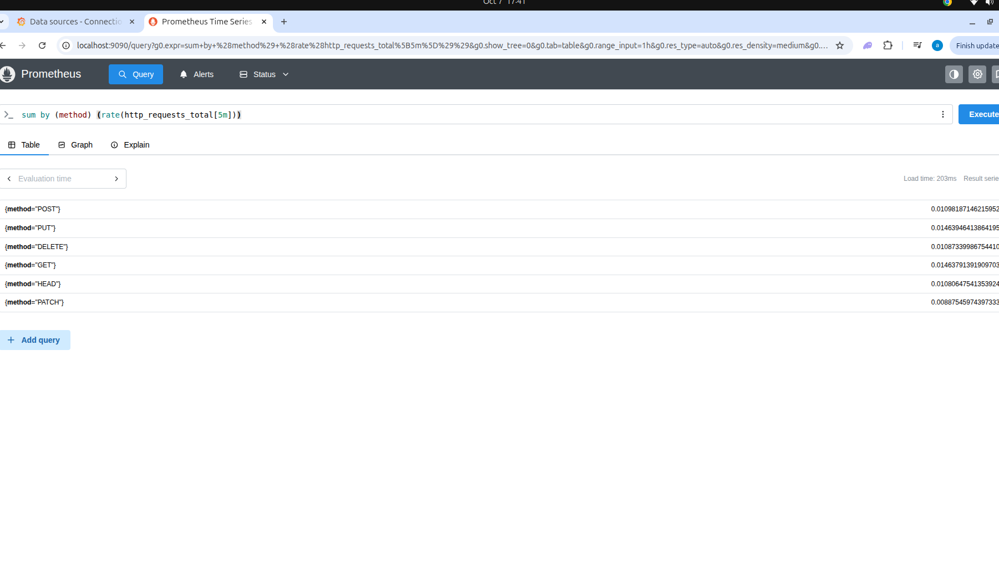
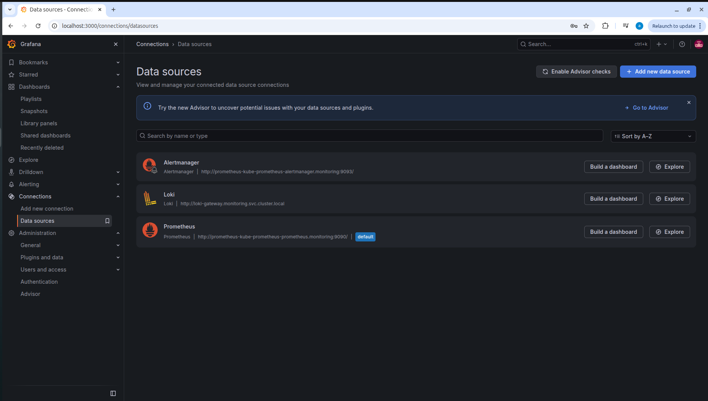
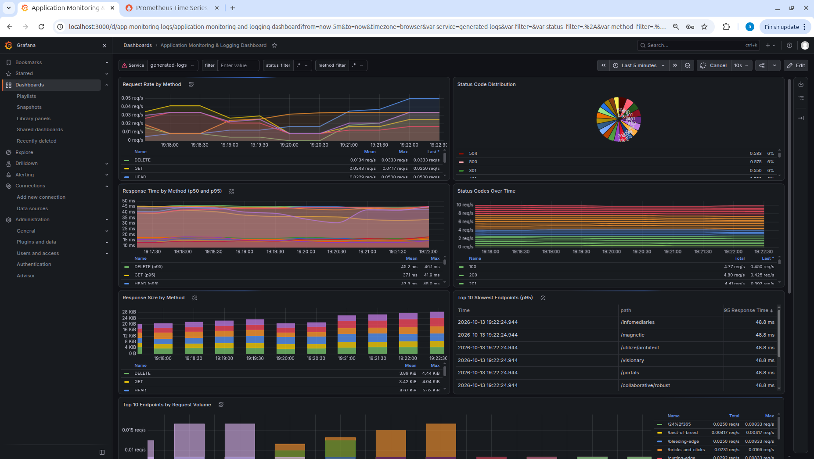
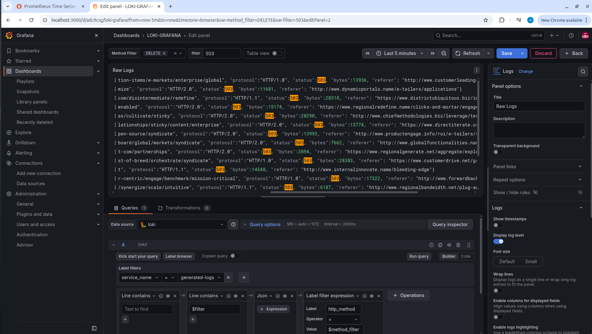
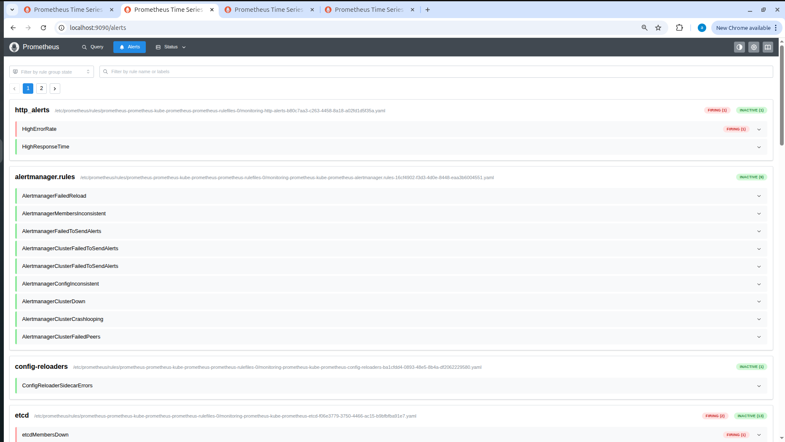

# Prometheus, Grafana and Loki Monitoring

## Project Summary

This project implements a Kubernetes monitoring and logging environment using Prometheus, Grafana, Loki, and Promtail. It brings together application metrics, log aggregation, dashboard visualisation, and alert-rule testing to demonstrate key aspects of monitoring and observability.

The practical work covered configuring Prometheus to collect application metrics, using Grafana to visualise metrics and logs, collecting generated logs through Promtail and Loki, and creating and testing Prometheus alert rules for high error rates and high response times. It also involved troubleshooting metric scraping, resource constraints, and connectivity issues in a local Kubernetes environment.

## Project Objectives

- Collect and query application metrics using Prometheus.
- Visualise metrics and logs through Grafana dashboards.
- Collect generated workload logs with Promtail and send them to Loki.
- Use PromQL to explore HTTP request rates.
- Use Grafana filters and LogQL to investigate log entries.
- Create and test Prometheus alert rules for error rates and response times.
- Troubleshoot scraping, resource, and local-cluster issues.

## Architecture Overview

```text
                         +----------------------+
                         |  Kubernetes workload |
                         +----------+-----------+
                                    |
                   +----------------+----------------+
                   |                                 |
              HTTP metrics                     Generated logs
                   |                                 |
                   v                                 v
          +------------------+              +------------------+
          | Metrics exporter |              |     Promtail     |
          +--------+---------+              +--------+---------+
                   |                                 |
                   | ServiceMonitor                  | Push logs
                   v                                 v
          +------------------+              +------------------+
          |    Prometheus    |              |       Loki       |
          +--------+---------+              +--------+---------+
                   |                                 |
                   +----------------+----------------+
                                    v
                             +-------------+
                             |   Grafana   |
                             +-------------+

                 PrometheusRule resources define alert conditions
```

Prometheus scrapes metrics exposed by the metrics exporter through a `ServiceMonitor`. Promtail reads generated log files and forwards entries to Loki. Grafana provides a single interface for exploring metrics and logs. Prometheus evaluates the configured alert rules.

## Technology Stack

| Technology | Purpose |
|---|---|
| Kubernetes / Minikube | Runs the monitoring stack and test workload locally |
| Prometheus | Scrapes and queries time-series metrics |
| Grafana | Visualises metrics and supports log exploration |
| Loki | Stores and queries logs |
| Promtail | Reads log files and forwards them to Loki |
| Prometheus Operator resources | Provide `ServiceMonitor` and `PrometheusRule` resources |
| Helm | Installs Loki using its chart |
| PromQL | Queries Prometheus metrics |
| LogQL | Filters and queries Loki logs |
| YAML / JSON | Define Kubernetes resources, Helm values, alert rules, and dashboard configuration |

## Project Structure

```text
loki-prometheus-grafana-kubernetes-logging-monitoring/
├── alerting/
│   └── alert-rules.yaml
├── grafana/
│   └── grafana-dashboard.json
├── images/
│   ├── grafana-dashboard.png
│   ├── grafana-data-sources.png
│   ├── loki-logs-503.png
│   ├── prometheus-alert-testing.png
│   └── prometheus-query-results.png
├── loki/
│   └── loki-values.yaml
├── prometheus/
│   └── prometheus-values.yaml
├── test/
│   └── fake-metrics-logs.yaml
└── README.md
```

## Implementation

### 1. Prometheus Metrics Monitoring

The test manifest defines a metrics exporter and a Kubernetes Service. A `ServiceMonitor` selects the exporter Service and defines the endpoint Prometheus scrapes. The scrape interval and timeout were adjusted during troubleshooting to suit the local environment.

The following PromQL query calculates the per-second request rate over a five-minute window, grouped by HTTP method:

```promql
sum by (method) (rate(http_requests_total[5m]))
```

This query can be used to compare request rates for methods such as `GET`, `POST`, `PUT`, `DELETE`, `HEAD`, and `PATCH`.



### 2. Grafana Data Sources

Grafana was configured to use Prometheus for metrics and Loki for logs. The Loki data source uses the in-cluster Loki gateway endpoint and the tenant header configured for this lab.



### 3. Grafana Monitoring Dashboard

The dashboard brings application metrics and log exploration into one view. The dashboard work includes request-rate views and panels for response time, response size, HTTP status codes, and endpoint statistics. Dashboard variables and filters help narrow the metric and log views.



### 4. Log Collection and Investigation with Loki

The test workload writes generated logs to a shared volume. Promtail reads the log file and forwards entries to Loki. In Grafana, LogQL and dashboard filters can be used to select log streams and search for particular values.

The screenshot below shows generated log entries filtered for HTTP `503` responses. This demonstrates a log-investigation workflow using test data, not a real production incident.



### 5. Prometheus Alert Rules and Testing

The `alerting/alert-rules.yaml` manifest defines two Prometheus alert rules:

- **HighErrorRate** — evaluates the rate of HTTP 5xx responses against a configured threshold.
- **HighResponseTime** — evaluates the 95th percentile of HTTP request duration against a configured threshold.

Both rules use a one-minute `for` duration, so the condition must persist before the alert transitions to Firing.

During testing, the `HighErrorRate` expression was temporarily changed to `vector(1) > 0` to verify the Pending-to-Firing transition. The original expression was restored after the test. This was a controlled rule test, not a real incident.



Alert-rule evaluation was tested in Prometheus. Alertmanager notification delivery was not configured and verified as part of this practical.

## Useful Commands

### Check the cluster

```bash
kubectl config current-context
kubectl get nodes
```

### Inspect monitoring resources

```bash
kubectl get pods -n monitoring
kubectl get services -n monitoring
kubectl get servicemonitor -n monitoring
kubectl get prometheusrule -n monitoring
```

### Inspect a workload during troubleshooting

```bash
kubectl describe pod <pod-name> -n monitoring
kubectl logs <pod-name> -n monitoring
```

If Minikube is stopped, start it before running Kubernetes checks:

```bash
minikube start
```

To access Grafana through the service used in this lab:

```bash
kubectl port-forward -n monitoring svc/prometheus-grafana 3000:80
```

Then open `http://localhost:3000` in a browser. Service names may differ depending on the Helm release and installation.

## Issues Encountered and Fixes

- **Metrics exporter scrape issues:** Investigated the `ServiceMonitor` selector, endpoint port, scrape interval, and scrape timeout.
- **Exporter resource pressure:** Increased the exporter memory limit after observing repeated `OOMKilled` events.
- **Local cluster performance:** Adjusted scrape settings to suit the resources available in the Minikube environment.
- **Connectivity and TLS handshake timeouts:** Restarted Minikube during troubleshooting and rechecked the monitoring resources.

A scrape interval controls how frequently Prometheus attempts to collect metrics. A scrape timeout controls how long Prometheus waits for an individual scrape to complete. Increasing the timeout alone does not reduce scrape frequency.

The Minikube environment is currently stopped. The screenshots document results captured during earlier practical sessions and should not be interpreted as proof that the cluster is currently running.

## Validation and Testing

The practical included querying HTTP request-rate metrics in Prometheus, reviewing dashboard views in Grafana, filtering generated logs in Loki, and observing the Prometheus alert transition through Pending and Firing during a controlled test. Kubernetes resource checks were also used during troubleshooting when the cluster was available.

Alertmanager notification delivery was not verified as configured.

## Lessons Learned

- Metrics and logs provide complementary views of application behaviour.
- Prometheus uses PromQL for time-series calculations, while Loki uses LogQL for log queries.
- `ServiceMonitor` labels, endpoint ports, intervals, and timeouts affect successful scraping.
- Resource limits can affect exporter reliability in a resource-constrained local cluster.
- Alert rules should be tested deliberately, and temporary test expressions should be restored afterward.
- Screenshots should be described as evidence from the session in which they were captured, not as proof of current cluster health.

## Author

**Anthony Chidi**
DevOps | Cloud Infrastructure | Kubernetes | Monitoring & Observability
